# Fleet Manager

The Fleet Manager (`takt-fleet`) extends `agent-takt` to coordinate work across multiple local takt projects from a single operator terminal. It is installed as a sibling entry-point alongside the `takt` CLI.

> **v0.1.0 scope note** — All registered projects must live on the local filesystem. Cross-project spec management and remote/SSH project support are out of scope for v0.1.0.

---

## Concepts

**Registry** — a YAML file (`~/.config/agent-takt/fleet.yaml` by default, XDG-aware) that maps names and tags to project root directories. All `takt-fleet` commands operate against this registry.

**Health** — a lightweight per-project liveness check run before listing or querying. Possible values:

| Status | Meaning |
|---|---|
| `ok` | Directory exists, `.takt/config.yaml` present, `takt --version` succeeds |
| `no-takt` | Directory exists but is not a takt project (missing `.takt/config.yaml`) |
| `missing` | Registered path does not exist on disk |
| `takt-error` | Directory and config exist but `takt --version` failed or timed out |

**Fleet run** — a logged record of a `dispatch` or `run` command. Each run gets an ID in the format `FR-<8 hex chars>`. Records are written to `~/.local/share/agent-takt/fleet/runs/` and are queryable with `takt-fleet runs`. Fleet runs cover only work started through `takt-fleet dispatch` or `takt-fleet run`; they are **not** a record of scheduler runs started directly with `takt run` (use [`takt-fleet scheduler-runs list`](#takt-fleet-scheduler-runs-list) for those).

**Filters** — most commands accept `--tag` and `--project` to scope which projects to target:
- `--tag TAG` is repeatable with AND semantics (all given tags must be present).
- `--project NAME` is repeatable with OR semantics (any listed name matches).

---

## Registry Setup

Register a project by pointing at its root directory:

```bash
takt-fleet register /path/to/project-a
takt-fleet register /path/to/project-b --name "backend" --tag api --tag prod
takt-fleet register /path/to/project-c --name "frontend" --tag ui

# List all registered projects (with health check)
takt-fleet list

# List only projects carrying the "prod" tag
takt-fleet list --tag prod

# Pipe-friendly output
takt-fleet list --plain

# Remove a project by name or path
takt-fleet unregister backend
```

The registry file format:

```yaml
version: 1
projects:
  - name: backend
    path: /path/to/project-b
    tags: [api, prod]
  - name: frontend
    path: /path/to/project-c
    tags: [ui]
```

Do not edit the file while `takt-fleet` commands are running — writes are atomic but concurrent access is not guarded.

---

## Command Reference

### `takt-fleet register`

```
takt-fleet register <path> [--name NAME] [--tag TAG ...]
```

Adds a project to the registry. If `--name` is omitted, the basename of `path` is used. Tags are free-form strings.

### `takt-fleet unregister`

```
takt-fleet unregister <path_or_name>
```

Removes a project from the registry. Does not touch the project directory.

### `takt-fleet list`

```
takt-fleet list [--tag TAG ...] [--plain]
```

Lists registered projects with a health check for each. Runs health checks sequentially. Use `--plain` for tab-separated output suitable for scripting.

### `takt-fleet dispatch`

```
takt-fleet dispatch --title TITLE --description DESC \
  [--agent developer|tester|documentation|review] \
  [--label LABEL ...] \
  [--max-parallel N] \
  [--tag TAG ...] [--project NAME ...]
```

Creates one bead in each target project concurrently. **Does not trigger execution** — follow up with `takt-fleet run` to run the scheduler across projects.

- Default agent type: `developer`
- Default concurrency: `min(projects, 4)` (override with `--max-parallel`)
- Results are printed as a per-project table and logged as a fleet run (`FR-…`).

Example:

```bash
# Fan out a bug fix bead to all "api" projects, then run
takt-fleet dispatch \
  --title "Fix null-pointer in auth middleware" \
  --description "Traced to line 42 in auth.py — add an early return on None." \
  --agent developer \
  --label hotfix \
  --tag api

takt-fleet run --tag api --runner claude
```

### `takt-fleet run`

```
takt-fleet run [--max-parallel N] [--runner codex|claude] \
  [--project-max-workers N] \
  [--tag TAG ...] [--project NAME ...]
```

Calls `uv run takt run` in each target project concurrently. Each project-level run is a subprocess call; its stdout/stderr are captured and summarised after all projects finish.

- `--runner` is passed as a global `takt` flag before the `run` subcommand (i.e. `uv run takt --runner <value> run …`), which is the required position for the flag to be recognised by takt.
- `--project-max-workers` is forwarded as `--max-workers` to each `takt run` subprocess.
- Results are printed as a per-project table and logged as a fleet run (`FR-…`).

### `takt-fleet summary`

```
takt-fleet summary [--json] [--plain] [--tag TAG ...] [--project NAME ...]
```

Prints an aggregated bead-count table across target projects. Columns: `PROJECT`, `DONE`, `READY`, `IN_PROGRESS`, `BLOCKED`, `HANDED_OFF`, `SCHEDULER`, `HEALTH`.

`SCHEDULER` shows the state of `takt run` in each project, taken from the `scheduler` object in that project's unscoped `takt summary` output (derived from the active-run markers in `.takt/runs/active/`, see [events.md](events.md#active-run-marker)):

| Value | Meaning |
|---|---|
| `running` | At least one active run whose process is alive on this host |
| `stale` | Active-run markers exist but none is confirmed alive (crashed run not yet reaped, or marker from another host) |
| `idle` | No active runs |
| `-` | Unknown: the project is unreachable or errored, or its installed takt predates scheduler state |

Use `--json` for machine-readable output (each row includes a `scheduler` object or `null`), `--plain` for tab-separated output.

### `takt-fleet watch`

```
takt-fleet watch [--since DURATION] [--tag TAG ...] [--project NAME ...]
```

Tails `.takt/logs/events.jsonl` in each target project and prints a merged live stream prefixed with the project name. Ctrl-C stops the watch.

- `--since DURATION` replays events from the given window before streaming live (e.g. `5m`, `1h`, `2d`). Without `--since`, starts from the current end of the file.
- Duration units: `s` (seconds), `m` (minutes), `h` (hours), `d` (days).
- A warning is printed when the requested window is older than the earliest event in the log.

Example output:

```
[backend]  2026-04-24T12:01:00Z  bead_started          B-abc12def  Add pagination to list endpoint
[backend]  2026-04-24T12:01:45Z  bead_completed        B-abc12def  Added pagination with tests
[frontend] 2026-04-24T12:01:50Z  scheduler_cycle_started  B-9516499d
```

Each line is `[project]  TIMESTAMP  event_type  bead_id (or feature_root_id)  detail`, where detail is the first of the payload's `summary`, `title` or `reason`, truncated to 120 characters.

### `takt-fleet scheduler-runs list`

```
takt-fleet scheduler-runs list [--limit N] [--since DURATION] \
  [--tag TAG ...] [--project NAME ...] [--plain] [--json]
```

Lists scheduler runs (`takt run` invocations) recorded in each target project's `.takt/logs/events.jsonl`, most recent first, merged across projects. This includes runs started directly with `takt run`, not only those launched by the fleet. Default limit: 20; `--since` filters by start time (units `s`, `m`, `h`, `d`).

Columns: `PROJECT`, `RUN_ID`, `STARTED_AT`, `DURATION`, `STATUS`, `CYCLES`, `BEADS` (started), `DONE`, `BLOCKED`, `COST`. Missing values render as `-`; with `--json` the raw run objects are emitted. With no matching runs it prints `No scheduler runs found.`

Rows are built by pairing `scheduler_run_started` and `scheduler_run_finished` events by `run_id` (see [events.md](events.md)). `STATUS` is the finished event's `exit_reason` (`quiescence`, `max_cycles`, `interrupted`, `terminated`, `error`, `crashed`). A run with no finished event is `running` if its active marker's process is alive on this host, otherwise `unknown`.

### `takt-fleet runs list`

> `runs` is the **fleet** run log: it lists only runs started via `takt-fleet dispatch` or `takt-fleet run`. For per-project scheduler runs, use `scheduler-runs list`.

```
takt-fleet runs list [--limit N] [--since DURATION] \
  [--status success|error|partial|in_progress] \
  [--command dispatch|run] \
  [--plain]
```

Lists recent fleet run records, most recent first. Default limit: 20.

Run status values:

| Status | Meaning |
|---|---|
| `in_progress` | Run has not yet finished (`finished_at` is null) |
| `success` | All projects succeeded |
| `error` | All projects failed |
| `partial` | Some projects succeeded, some failed |

### `takt-fleet runs show`

```
takt-fleet runs show <run_id> [--json]
```

Shows details for a fleet run. Run IDs can be shortened to an unambiguous prefix (e.g. `FR-a1b2`).

- If the run is still in progress, the command tails the live run log and prints each project result as it arrives.
- If the run is finished, a full breakdown (per-project status, bead IDs for dispatches, duration, aggregate) is printed.
- Use `--json` to dump the raw run log record without live-tailing.

### `takt-fleet serve`

Serves a read-only web UI over the registered projects: a live overview of every project, a merged activity feed, and a per-project page. The server runs in the foreground until stopped (Ctrl-C). It is not a daemon and keeps no database; everything it shows is read from each project's `.takt/` files and the fleet registry (see ADR-1897d241 and ADR-31a0427e).

**Install.** The web stack (Starlette and uvicorn) is an optional extra, so the core install is unchanged:

```bash
uv sync --extra fleet-ui                 # in a checkout
pip install 'agent-takt[fleet-ui]'       # from a package
```

Without the extra, `takt-fleet serve` exits 1 with an install hint. All other fleet commands work without it.

```bash
uv run takt-fleet serve                  # http://127.0.0.1:8765
uv run takt-fleet serve --port 0 --open  # free port, open the browser
uv run takt-fleet serve --demo           # generated demo data
```

| Flag | Default | Meaning |
|---|---|---|
| `--host ADDR` | `127.0.0.1` | Bind address |
| `--port N` | `8765` | Bind port; `0` picks a free port |
| `--allow-remote` | off | Permit binding to a non-local host |
| `--poll-interval SECONDS` | `1.0` | Change-detection poll interval |
| `--demo` | off | Serve generated demo projects instead of the registry |
| `--open` | off | Open the browser at the server URL |

**Localhost and remote rule.** The server has no authentication, and traces and transcripts contain code and conversation content. It binds to `127.0.0.1` by default. Local hosts are `127.0.0.1`, `::1` and `localhost`. Any other `--host` without `--allow-remote` is refused with exit code 2. With `--allow-remote` the server starts and prints a warning that traces and transcripts may be reachable by other machines without authentication. A port that cannot be bound exits 1.

**Demo mode.** `--demo` builds fixture projects in a temporary directory, drives synthetic scheduler activity against them and removes the directory on exit. The real registry is not used. The fixtures are the source of the screenshots below.

**Screens.**

Overview (`#/`): one card per project showing health, takt version (with drift against the installed version), scheduler state, bead counts and last event time. Cards update live.

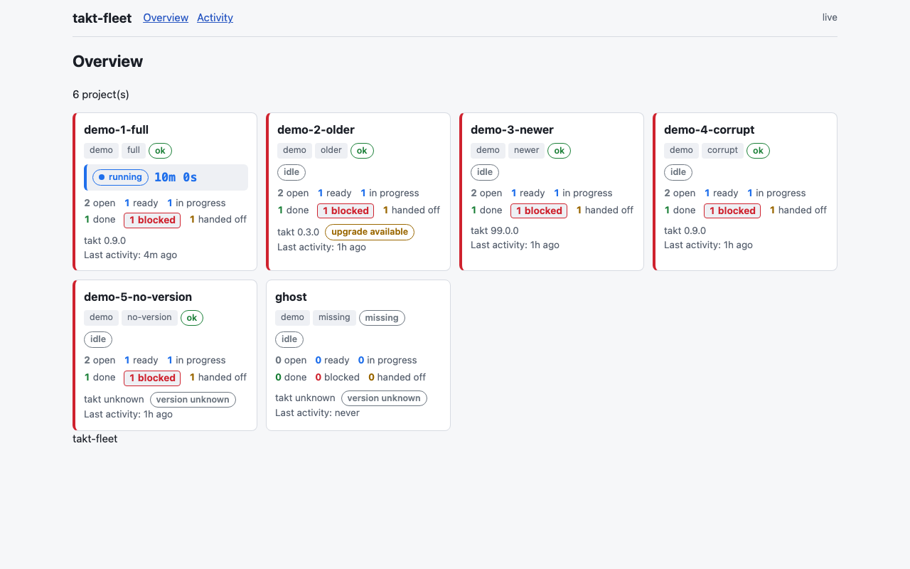

Activity (`#/activity`): a live feed of events merged across all projects, newest first, filterable by project. The feed loads one page (25 events) and a **Load older** button fetches the next page using the `next_cursor` from `/api/events`; new events stream in at the top over SSE.

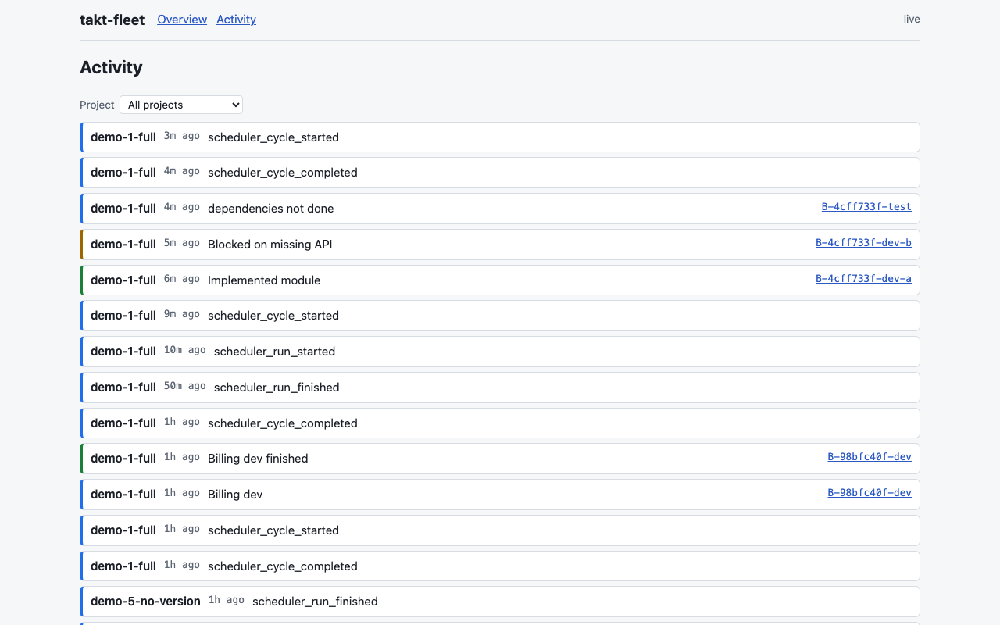

Project (`#/projects/<name>`): a "running since" line linking to the active run (when a scheduler run is active), the most recent features and beads with links to the full lists (**View all features**, **View all beads**), a footer with the last run, a link to all runs and a feed of the project's recent activity with a link to the full activity screen. Everything refetches live.

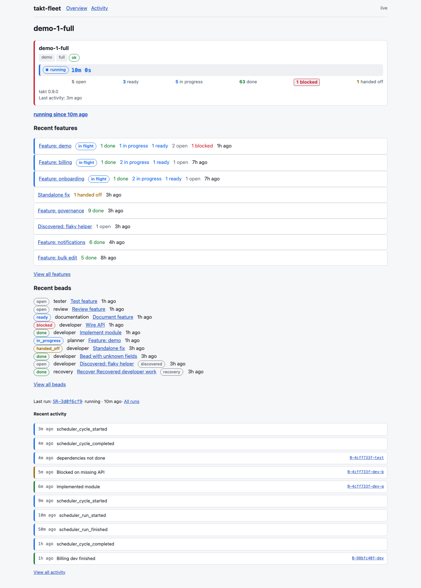

Live now strip (top of `#/`): one row per live agent session across the fleet (bead title, project, agent type, elapsed time, latest activity), each linking to the live session page. The strip is hidden when no session is live.

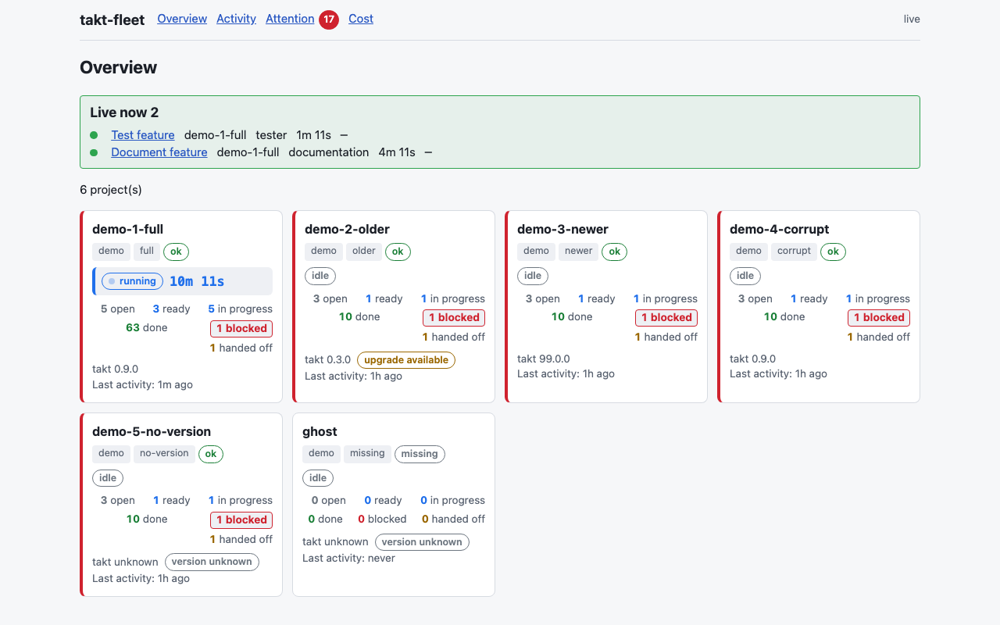

Live session (`#/projects/<name>/beads/<bead_id>/live/<session_id>`): watches one running Claude Code session. A header shows bead, agent, role, start time, elapsed time and a `live` / `ended` status; below it a summary (tool calls, errors, tokens) and the normalised transcript events (assistant text, tool calls and results). New events append as they are written, with an auto-scroll toggle. Bead detail pages carry a **Watch live** link while the bead has a live session, and for 10 minutes after its latest session ended (the page then shows the ended status and links to the captured trace).

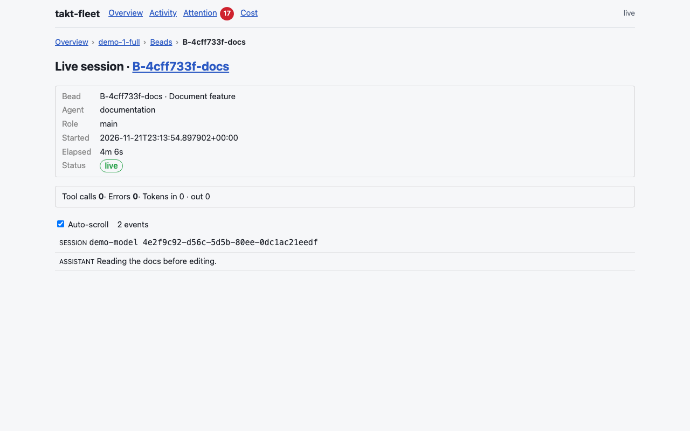

Attention (`#/attention`): everything that needs an operator across the fleet, in sections: blocked beads (with block reason and corrective attempts used/remaining), discovered issues (open beads labelled `discovered`), unmet acceptance criteria and structural assumptions (both only for feature trees that have not been merged) and stale scheduler runs. Items link to the bead or feature. The nav shows a badge with the total count.

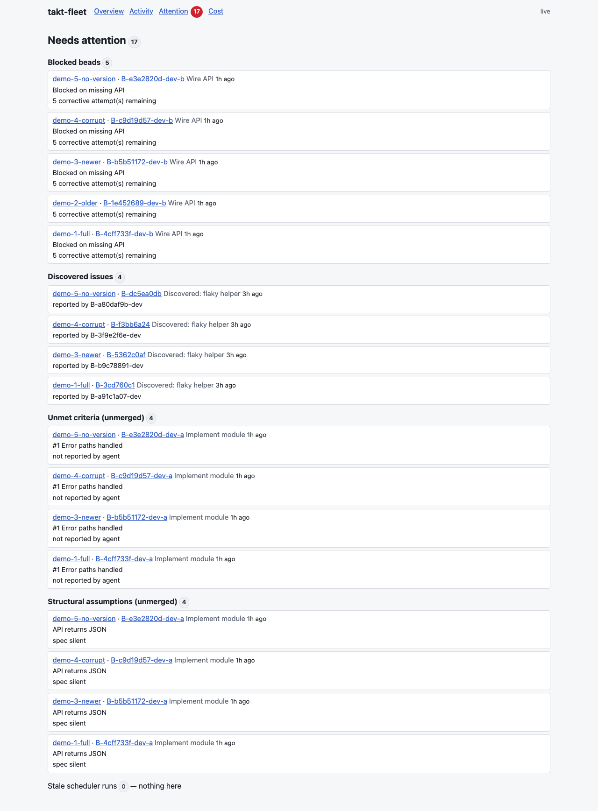

Cost (`#/cost?days=7|30|90`, default 30): fleet spend over the window, taken from the `cost_usd` of `bead_completed`, `bead_blocked` and `bead_failed` events. It shows the total, a hand-built SVG stacked bar chart of daily cost by project (no charting library), and tables by project, by agent type and the top 10 beads. Events without a numeric cost are counted separately ("events without cost") and never summed.

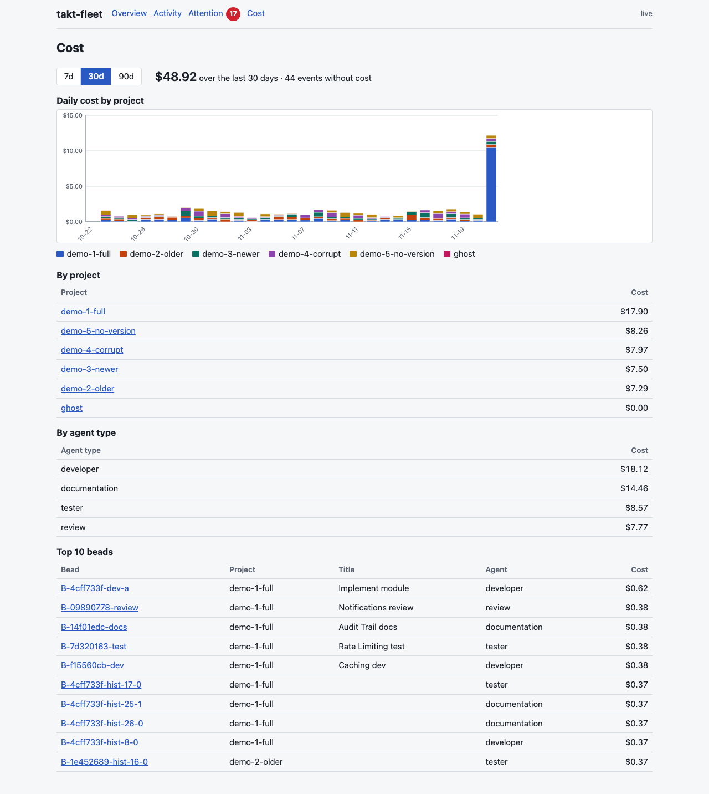

**Live sessions.** Live sessions are Claude Code only. They are read from the Claude transcripts that Claude Code writes while a session runs, at `<claude config dir>/projects/*/<session_id>.jsonl`, where the config dir is `$CLAUDE_CONFIG_DIR` if set, else `~/.claude`. The transcript is opened read-only and normalised with the same code as trace capture. Codex runs and planner sessions are not shown. A session is found through the `agent_session_started` event in the project's `events.jsonl` (see [events.md](events.md#agent_session_started)); this relies on the project running a takt version that emits it. A session counts as live when:

- no later `trace_captured` event carries its `session_id`;
- no later `bead_completed`, `bead_blocked` or `bead_failed` event exists for its bead; and
- it started less than 6 hours ago (older starts with no end event are treated as abandoned).

An ended session stays reachable for 10 minutes after the end event. Transcripts contain code and conversation content, so the localhost rule above applies to them too.

**Demand gating.** The server reads transcripts only while someone is looking: while at least one SSE client is connected, or for 60 seconds after the last request to a live route (`/api/live` or a bead or session `live` route). With no demand the stream hub still tracks `agent_session_started` and end events from `events.jsonl` but does not touch transcripts. The server keeps a bounded set of transcript followers (least recently used first out) and each follower reads incrementally from its last offset.

**Explorer screens.** The project screen links into a per-project bead explorer. Screens are hash routes; beads, features, traces and telemetry refetch automatically when a `beads_changed` event names the project (see SSE events below).

Features (`#/projects/<name>/features`): one row per feature root, in-flight trees first, then newest activity. Each row rolls up bead status counts, acceptance criteria (met/unmet/descoped), structural/local assumptions, cost and wall-clock time across the tree.

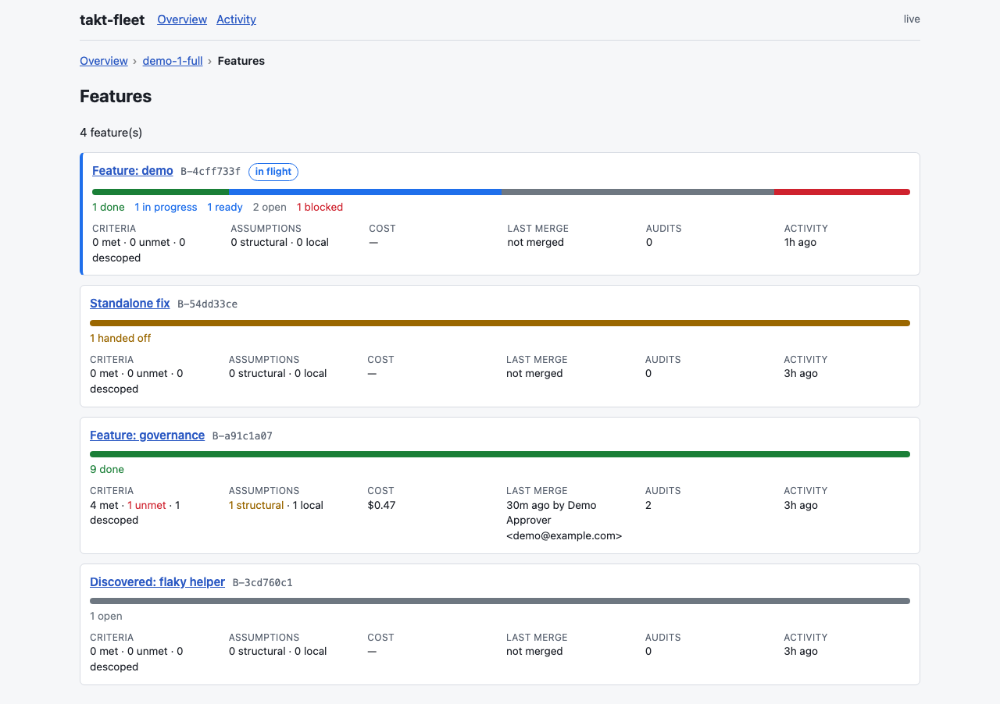

Feature tree (`#/projects/<name>/features/<root_id>`): the bead tree of one feature with status, agent type and dependencies per node, merge records, and links to the stored audit snapshots.

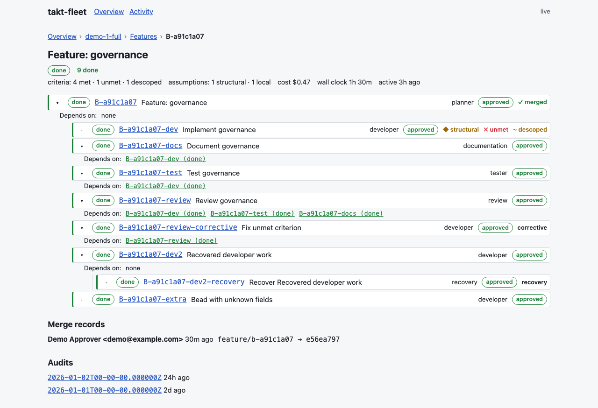

Audit (`#/projects/<name>/features/<root_id>/audits/<audit_id>`): a stored audit snapshot (written by `takt merge`) rendered read-only. The fleet never builds audits; it shows what is on disk.

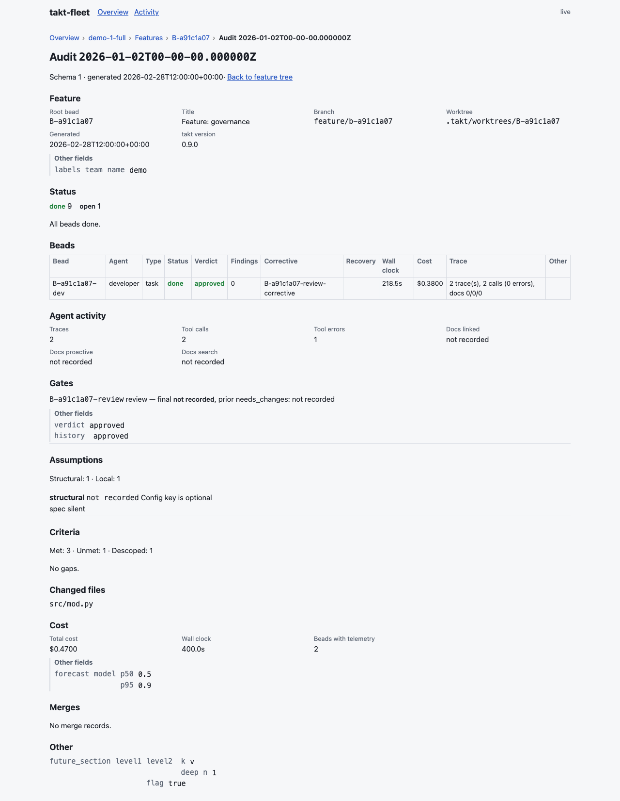

Beads (`#/projects/<name>/beads`): a paged, filterable table of the project's beads, newest first (status, agent, label and a text search over id and title). The first page holds 25 rows; a load-more control fetches the next page with `cursor`, and `total` shows the full match count.

Runs (`#/projects/<name>/runs`): a paged list of the project's scheduler runs, newest first, with status, start time, duration, exit reason, workers and runner. Workers and runner are hidden below 480 px so the page never scrolls sideways. A run with no finish event and no live marker shows the `stale` badge. Load more follows `next_cursor`.

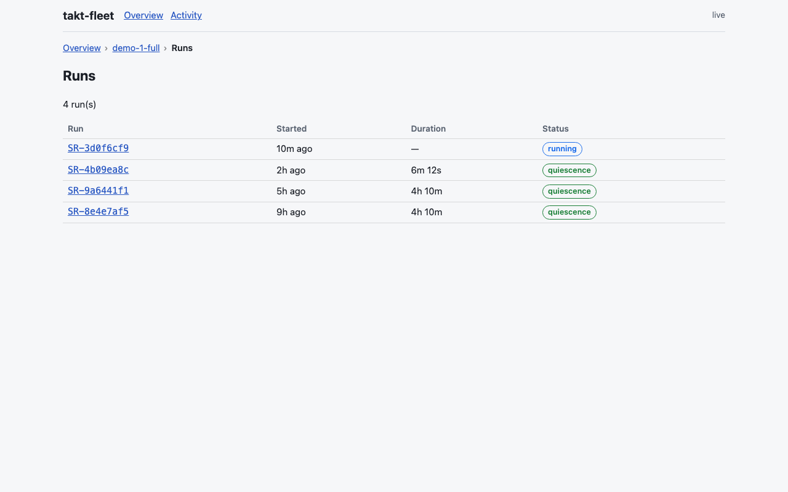

Run (`#/projects/<name>/runs/<run_id>`): one scheduler run. A header shows status, start, duration, exit reason, workers, runner and total cost (when beads report a cost); below it a cycle timeline (started/completed/blocked/deferred counts per cycle) and a table of the beads the run touched, with agent, outcome, duration, cost and a link to each bead. A running run updates live.

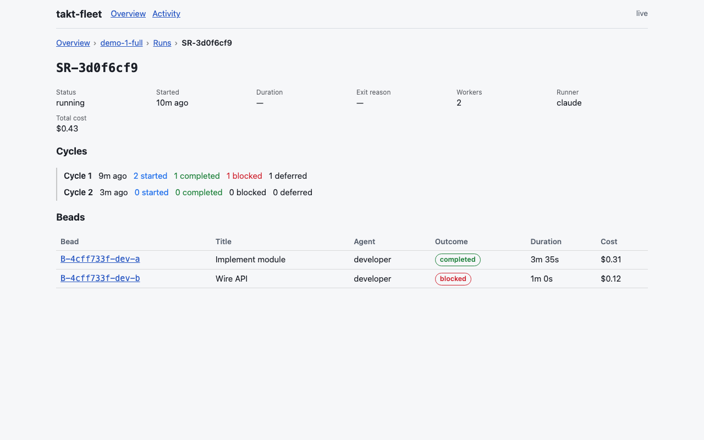

Bead detail (`#/projects/<name>/beads/<bead_id>`): a set of collapsible, colour-coded sections: summary, description, acceptance criteria with `criteria_status`, handoff narrative, assumptions (structural first), files, dependencies and children, history, cost and attempts, traces, discovered issues and raw JSON. A blocked bead shows its block reason prominently. The layout follows the system light or dark colour scheme and fits a 360 px wide screen without horizontal scrolling.

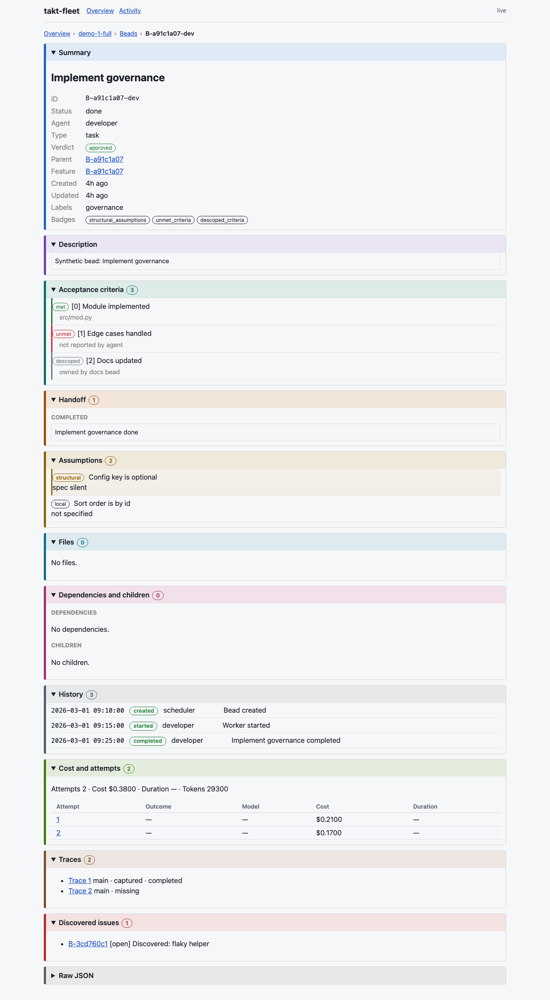

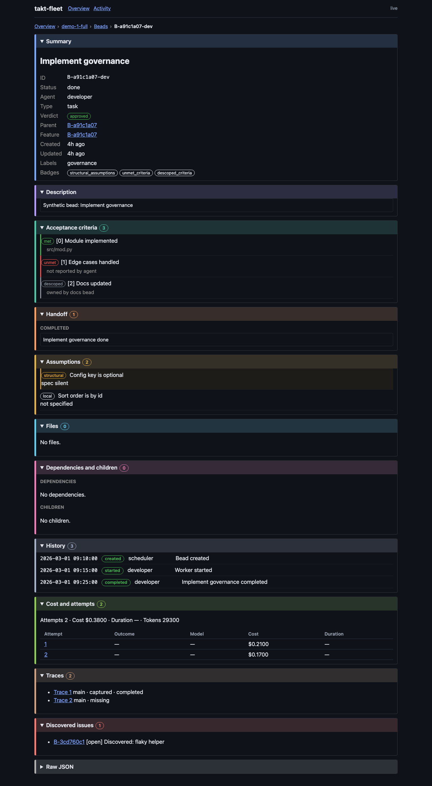

Trace (`#/projects/<name>/beads/<bead_id>/traces/<seq>`): one captured agent session as a paged event list with a tool/command summary and filters for event kind, tool name and errors only. Traces can contain code and conversation content (see the localhost rule above).

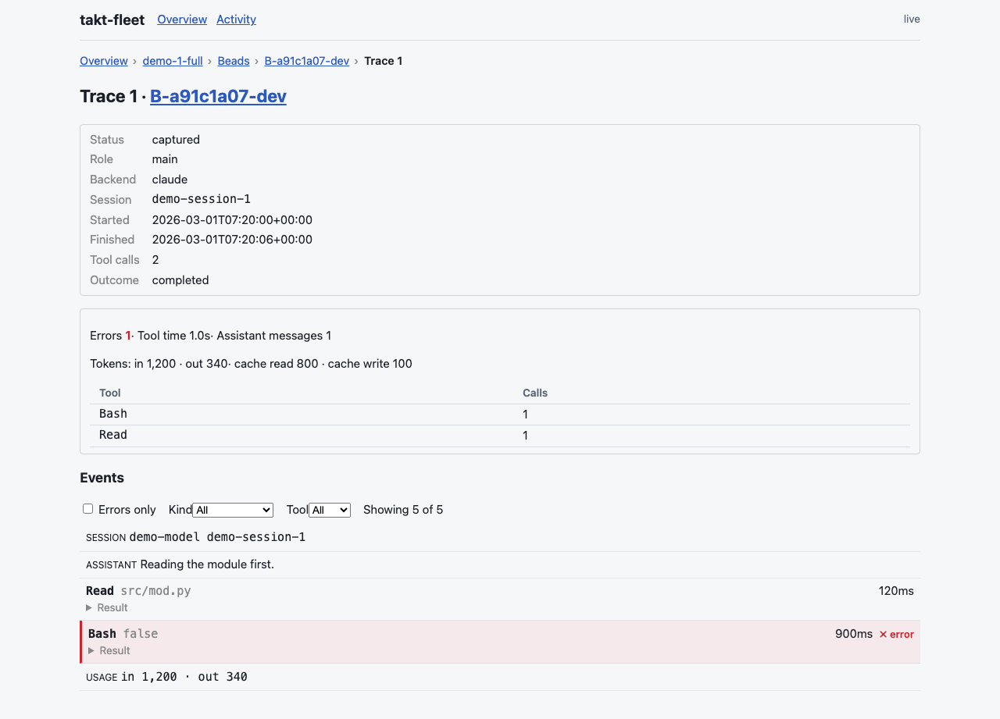

Telemetry (`#/projects/<name>/beads/<bead_id>/telemetry/<attempt>`): one execution attempt's runner telemetry, including the prompt and response text.

**API routes.** All routes are `GET` and read-only. No route creates beads or starts runs. The frontend is a vendored Preact + htm app served from `src/agent_takt_fleet/web/static/` with no build step (ADR-73d258d5).

| Route | Response |
|---|---|
| `/` | The single-page app (`index.html`); static assets are mounted under `/static` |
| `/api/fleet` | `{installed_version, projects, generated_at}`; `projects` is a list of project cards |
| `/api/projects/{name}` | One project card plus `scheduler_runs` (up to 20, newest first); 404 `{"error": ...}` for an unknown project |
| `/api/projects/{name}/beads` | `{beads, total, limit, next_cursor}`: bead rows, newest first by default. Query: `status` and `agent` (repeatable, OR within each), `label` (repeatable, AND), `feature_root=<id>` (exact), `q=<text>` (case-insensitive substring of id or title), `order=newest\|oldest` (default `newest`), `limit=<n>` (default 25, clamped to 1..200), `cursor=<opaque>`. `total` counts all matches before paging. `next_cursor` is `null` on the last page. 400 `invalid order: <x>` or `invalid cursor`; 404 for an unknown project; an unreadable bead set yields `{beads: [], total: 0, limit, next_cursor: null}` |
| `/api/projects/{name}/beads/{bead_id}` | Full bead detail view model (row, description, criteria, handoff, assumptions, files, dependencies, children, history, traces, discovered issues). 404 `{"error": "unknown bead: <id>"}` for an unknown project or bead, an id with unsafe characters, or an unreadable bead (`bead unreadable`) |
| `/api/projects/{name}/beads/{bead_id}/traces/{seq}` | `{meta, summary, events, total, offset, limit}` for one trace record. `seq` must be an integer present in the bead's trace listing. Query: `offset` (default 0), `limit` (default 200, max 1000), `kind=<event kind>`, `tool=<tool name>`, `errors_only=1`. `total` is the filtered count; `summary` always covers every event. 404 for an unknown project, bead or `seq` (`unknown trace: <bead>/<seq>`) |
| `/api/projects/{name}/beads/{bead_id}/telemetry/{attempt}` | One telemetry attempt as written; `prompt_text` and `response_text` are cut to 256 KiB with `prompt_truncated` / `response_truncated` flags. `attempt` must be an integer matching an existing attempt file. 404 for an unknown project, bead or attempt (`unknown attempt: <n>`) |
| `/api/projects/{name}/features` | `{features, total}`: one rollup per feature root. An unreadable bead set yields `{features: [], total: 0}`. 404 for an unknown project |
| `/api/projects/{name}/features/{root_id}` | Feature entry, nested bead tree, merge records and the list of stored audits. 404 `unknown feature: <id>` when `root_id` is not a feature root, is unsafe, or the feature is unreadable |
| `/api/projects/{name}/features/{root_id}/audits/{audit_id}` | A stored audit snapshot as written, plus `audit_id` and `generated_at`. `audit_id` must match an existing snapshot under `.takt/audits/<root_id>/`. 404 for an unknown project, feature or audit (`unknown audit: <id>`) |
| `/api/projects/{name}/runs` | `{runs, total, limit, next_cursor}`: scheduler runs newest first, each row with `duration_seconds` (`null` while unfinished). Query: `limit=<n>` (default 25, clamped to 1..200), `cursor=<opaque>`. 400 `invalid cursor`; 404 for an unknown project |
| `/api/projects/{name}/runs/{run_id}` | `{run, cycles, beads, correctives_created, total_cost_usd}` for one run: `cycles` carry start/finish times and started/completed/blocked/deferred counts; `beads` carry `bead_id`, `title`, `agent_type`, `outcome`, `duration_seconds`, `cost_usd`, `cycle_index`; `total_cost_usd` is `null` when no bead event reports a cost. 404 `unknown run: <id>` for an unknown project, a malformed `run_id` or a run not in the log |
| `/api/live` | `{sessions, count, generated_at}`: every live session across the fleet, newest start first. Each row carries project, bead, `session_id`, agent type, role, `started_at`, elapsed time and a transcript summary |
| `/api/projects/{name}/beads/{bead_id}/live` | The bead's live sessions plus its latest session that ended within 10 minutes (`ended: true`). 404 for an unknown project or bead |
| `/api/projects/{name}/beads/{bead_id}/live/{session_id}` | `{project, bead_id, session_id, meta, summary, error, after, event_count, events}`: session meta (including `ended`, `ended_at`, `end_reason`, `trace`), the transcript summary and normalised events with index `>= after`, each carrying its `index`. Query: `after=<n>` (default 0; non-numeric is 400 `invalid after`); poll with the last `event_count` to receive only new events. 404 for an unknown project, bead or session, or an invalid session id (no transcript access happens for those) |
| `/api/attention` | `{blocked, discovered, unmet_criteria, structural_assumptions, stale_runs, total, generated_at}`; each section is `{count, items}` newest first, and every item has `project`, `bead_id` and `feature_root_id` link targets (stale runs carry project and run instead) |
| `/api/cost` | `{days, dates, ...}`: spend over the window with per-project daily series aligned to `dates`, totals by project and agent type, the top beads and `null_cost_events`. Query: `days=7\|30\|90`; any other or non-numeric value falls back to 30 (it is not rejected) and the response echoes the `days` used |
| `/api/events` | `{events, limit, next_cursor}` merged newest first. Query: `project=<name>`, `limit=<n>` (default 25, clamped to 1..200), `cursor=<opaque>`. 400 `invalid cursor` |
| `/api/stream` | Server-Sent Events stream (below) |

**Paging.** The bead, run and event lists share one scheme. Pass `limit` for the page size (values outside the range are clamped; non-numeric values fall back to the default). Each response includes `limit` (the size actually used) and `next_cursor`. To get the next page, repeat the same request with `cursor=<next_cursor>`; stop when `next_cursor` is `null`. Cursors are opaque, so clients must not parse or build them. A cursor is only valid for the list that issued it (a runs cursor sent to the beads route is a 400), and a malformed or foreign cursor returns 400 `{"error": "invalid cursor"}`. Event cursors record a per-project position in each `events.jsonl`, so events appended after the first page do not shift later pages. Bead and run cursors are offsets into the sorted list, so beads or runs created between page requests can shift a page boundary.

Path parameters (`bead_id`, `root_id`, `audit_id`, `run_id`) are validated against a safe-identifier pattern and are only matched against directory listings, never joined into file paths, so traversal-style input returns 404. Non-numeric `offset`/`limit` values fall back to their defaults.

A project card has `name`, `path`, `tags`, `health`, `takt_version`, `version_drift`, `scheduler` (`state`, `run_id`, `started_at`), `bead_counts`, `unreadable_beads` and `last_event_at`. An event item has `project`, `timestamp`, `event_type` and `payload`, plus derived display fields. Files are read tolerantly: a malformed project yields a degraded card, not an error response.

**SSE events** on `/api/stream`:

| Event | Data | Sent when |
|---|---|---|
| `fleet_event` | One event item | A new line is appended to a project's `events.jsonl` (each client tails from the moment it connects) |
| `project_updated` | A full project card | A project's card changed |
| `fleet_changed` | The full fleet body | The registry content changed |
| `beads_changed` | `{project, bead_ids}` | One or more `.takt/beads/*.json` files of a project were added, removed or modified; `bead_ids` is the sorted list of affected ids. The first observation of a project only sets a baseline, so no event is sent for it. The client refetches the affected beads, features, bead-detail and trace views |
| `live_session_started` | `{project, bead_id, session_id}` | An `agent_session_started` event is seen for a session the hub was not yet tracking (also seeded for sessions already live when the server starts, without an event) |
| `live_session_updated` | `{project, bead_id, session_id, event_count}` | A tracked session's transcript has grown. Only sent while there is live demand (see above) |
| `live_session_ended` | `{project, bead_id, session_id}` | A `trace_captured` event names the session, or its bead reports `bead_completed`, `bead_blocked` or `bead_failed` |
| `: ping` (comment line) | none | Heartbeat every 15 seconds when idle; not a named event |

Change detection polls file sizes and mtimes, so updates lag by up to `--poll-interval`.

**Running the UI tests.** Browser smoke tests are marked `ui` and are skipped when Playwright Chromium is not available:

```bash
uv sync --all-extras
uv run playwright install chromium
uv run pytest tests/ -m ui
```

API and SSE tests run in the normal suite (`uv run pytest tests/ -n auto -q`). CI runs the `ui` marker in a separate `ui-tests` job. The three-layer testing approach is recorded in ADR-f42387c6.

---

## Operator Workflow

### Daily driver pattern

```bash
# See the health and bead counts across all projects
takt-fleet summary

# Fan out a task to all projects tagged "backend", then run
takt-fleet dispatch --title "…" --description "…" --tag backend
takt-fleet run --tag backend --runner claude --project-max-workers 4

# Watch progress live
takt-fleet watch --tag backend

# Review results after completion
takt-fleet runs list --limit 5
takt-fleet runs show FR-<id>
```

### Targeting a subset

```bash
# Run only specific projects by name
takt-fleet run --project "project-a" --project "project-c"

# Combine tags and names (tags AND-filter; names OR-filter)
takt-fleet dispatch --title "…" --description "…" --tag prod --project "project-a"
```

### Scripting

```bash
# Machine-readable summary
takt-fleet summary --json | jq '.projects[] | select(.health != "ok")'

# Pipe-friendly run log
takt-fleet runs list --plain | awk -F'\t' '$8 == "error" {print $1}'
```

---

## Fleet Read Contract

[project-files.md](project-files.md) is the fleet read contract (ADR-1897d241). It documents the `.takt/` files the fleet may read from a project: beads, traces, audit snapshots, telemetry, `version.json`, `events.jsonl` and active-run markers. The fleet reads only those files, as plain JSON and read-only, and tolerates version drift between itself and each project. Mutations still go only through the `takt` CLI.

---

## Run Log

Fleet runs are persisted to `~/.local/share/agent-takt/fleet/runs/` (XDG-aware; override with `XDG_DATA_HOME`). Each file is named `<run_id>.json` and is written atomically.

Run records survive process crashes — if the fleet process is killed mid-run, the existing partial record remains on disk with `crashed: true` and whatever project results had been written before the crash. The next `runs show <id>` will display the partial results.

Run files from newer versions of `takt-fleet` that the current installation does not understand are silently skipped with a logged warning.

---

## Environment Variables

| Variable | Default | Purpose |
|---|---|---|
| `XDG_CONFIG_HOME` | `~/.config` | Registry location: `$XDG_CONFIG_HOME/agent-takt/fleet.yaml` |
| `XDG_DATA_HOME` | `~/.local/share` | Run log location: `$XDG_DATA_HOME/agent-takt/fleet/runs/` |

---

## Out of Scope (v0.1.0)

- Cross-project spec planning or shared bead graphs across multiple repositories.
- Remote or SSH-accessed projects.
- Push-based event streaming from the scheduler (`watch` polls at 1-second intervals; `serve` pushes to browsers over SSE, driven by file polling).
- Remote access to the web UI beyond the explicit `--allow-remote` opt-in; there is no authentication.
- Automatic execution after `dispatch` — operators must run `takt-fleet run` explicitly.
